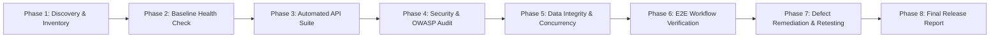

# QA AUDIT PLAN — MYRECRUITER TIER 2

**Application Name:** MyRecruiter Tier-2  
**Version:** 1.0.6  
**Audit Team:** Autonomous Software Quality & Reliability Engineering Team  
**Date of Execution:** October 16, 2026  
**Environment:** Windows 11 / Node.js v22.14.0 / PostgreSQL (Supabase) / Electron 41.7.0  

---

## 1. Executive Mission & Scope
The objective of this audit is to conduct an independent, exhaustive, evidence-based verification of the MyRecruiter application. This involves deep static code analysis, live runtime verification, API automated testing, database integrity assessment, security threat modeling, end-to-end user workflow tracing, and active defect remediation.

### In-Scope Systems:
1. **Frontend Client:** `public/index.html`, `public/assets/js/workflows.js`, `public/portal/review.html`, custom CSS stylesheets.
2. **Backend API Server:** `src/server/index.ts` (Express 5.2.1, 130+ API endpoints), middleware, authentication, session validation.
3. **Database Layer:** `src/services/database.ts`, PostgreSQL schemas (24 relational tables), SQLite fallbacks, LanceDB vector storage.
4. **Desktop Wrapper:** `src/desktop/main.ts` (Electron main process, single instance lock, IPC, auto-updater).
5. **Role-Based Workflows:**
   - **Recruiter:** Candidate sourcing (local folder scan, boolean search, manual ingestion), job association, candidate submission to Team Lead.
   - **Team Lead:** QC desk, candidate fit review, structured rejection with reason code, submission clearance to Account Manager.
   - **Account Manager:** Client requisition handling, candidate submission to Client Spoke, Spoke review token generation, hiring funnel progression.
   - **Client Spoke:** External zero-login portal (`/portal/review?token=...`), 1-click shortlist for interview (auto-scheduling), screening rejection, salary counter-negotiation.
   - **Management / Admin:** Agency-wide performance analytics, conversion funnels (Recruiter, TL, AM, Client, Spoke), team hierarchy, AI strategic insights.
6. **Integrations:**
   - Google Gemini Generative AI (`@google/generative-ai`)
   - LanceDB Vector Database (`@lancedb/lancedb`)
   - SMTP Email / Nodemailer (`nodemailer`, `imap-simple`, `mailparser`)
   - Resume Document Parsing (`pdf-parse`, `mammoth`, `cheerio`)

### Out-of-Scope:
- Production database deletion/purging (all testing conducted with synthetic test fixtures and rollback protection).
- Third-party live email spamming (mocked/sandboxed email transport).

---

## 2. Testing Methodology & Strategy

### Verification Criteria:
1. **Zero Fake Pass:** A feature is never marked PASS merely because a UI button is rendered or code exists without exercising the execution path.
2. **Root-Cause Remediation:** All confirmed defects must be fixed at their architectural root cause rather than hidden with cosmetic workarounds.
3. **Regression Safety:** Any change to the server or UI must be validated via clean build (`npm run build`) and targeted integration test scripts.

---

## 3. Assumptions & Limitations
- **Local Execution:** Testing is performed directly on the host development workstation.
- **Database Connection:** Connected to the active PostgreSQL database specified in `.env`.
- **Licensing:** Verification includes license verification bypass and license enforcement behavior.
