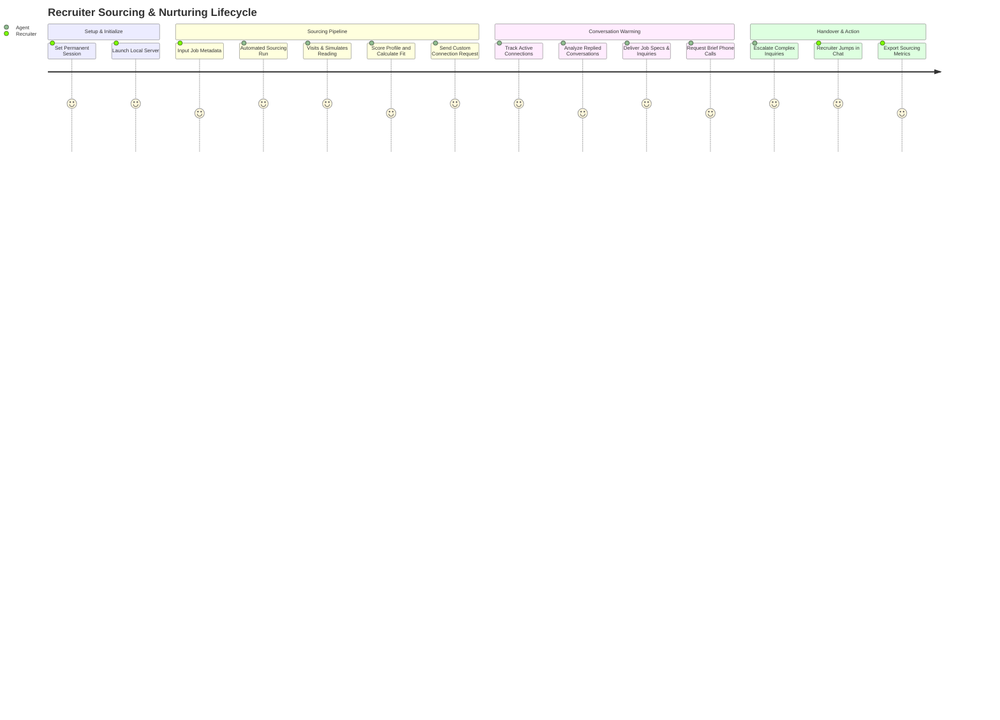
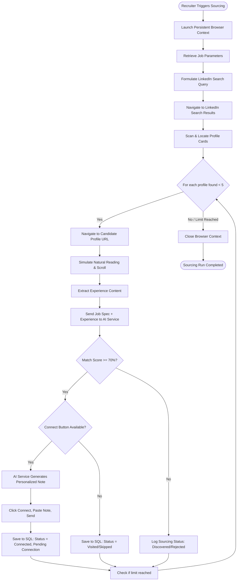
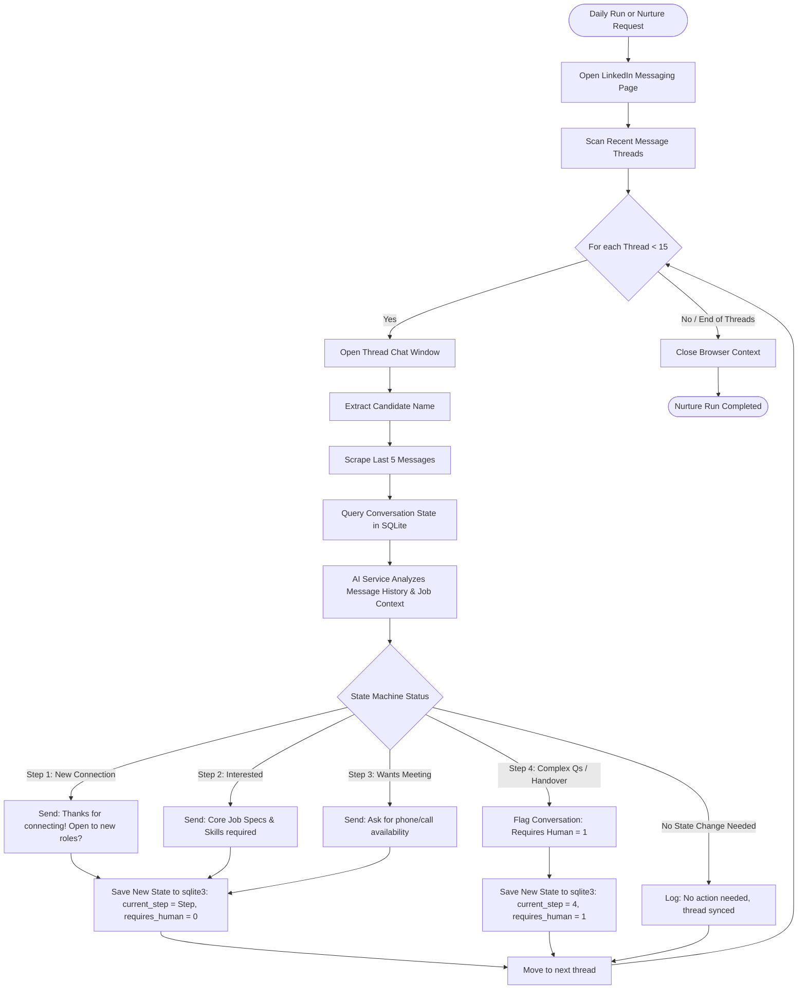

# 🚀 LinkedIn Hybrid Recruiter Agent: Product Blueprint

This blueprint describes the product features, user journey, and core workflows of the **LinkedIn Hybrid Recruiter Agent (Command Center)**. It details how the local-first node/express application integrates high-fidelity human browser emulation (Playwright) and hybrid artificial intelligence (Ollama local + Gemini Cloud) to automate sourcing and recruiting.

---

## 🛠️ Key Product Features

The architecture is divided into five core capabilities, which together form a secure, stealth-focused, autonomous outreach agent.

| Feature Module | Technical Components | Details & Safety Protocols |
| :--- | :--- | :--- |
| **1. Command Center (UI & API)** | `public/index.html`<br>`src/server/index.ts` | A stunning, glassmorphic dark-mode dashboard displaying live sourcing metrics, active jobs, admin actions, and real-time logs. Serves as a control deck to manage jobs and trigger automation runs. |
| **2. Autonomous Sourcing Engine** | `src/bot/scrapers/searcher.ts`<br>`src/services/ai.ts` | Performs smart, dynamic query generation (incorporating title, city, region state fallback, broad title, and remote state modifiers) avoiding literal searches for 'Statewide' or 'Countrywide'. Emulates human scrolling patterns, scraping candidate Headlines, About summaries, Experience descriptions, and Skills. |
| **3. AI Candidate Matching** | `src/services/ai.ts` | Dual-model intelligence using strict, high-fidelity parsing. Extracts all mandatory skills and job role experience details from the JD, validating them strictly against scraped candidate profile texts. Candidates missing ANY mandatory skill or experience criteria are scored < 70, ensuring they are excluded from automated connection requests. |
| **4. Multi-Stage Nurture Agent** | `src/bot/scrapers/conversation_agent.ts` | Drives automated, conversational lead warming in LinkedIn Messenger using a structured, stateful outreach sequence (Step 1-4) with built-in human intervention. |
| **5. Memory & Archiving** | `src/bot/scrapers/messages.ts`<br>`src/services/database.ts` | Syncs active message threads to a local SQLite database (`database.sqlite`). Summarizes threads using LLMs, categorizes status, and logs engagement logs. |
| **6. Broadcast & Posting** | `src/bot/posting.ts`<br>`src/bot/scrapers/groups.js` | Generates highly engaging, custom recruitment feed posts based on job details and publishes them directly to the user's LinkedIn feed. |
| **7. Chronological Reporting** | `src/services/reporter.ts` | Generates executive daily reports in CSV format, mapping outreach statistics, connection acceptances, pending requests, and reply rates. |

---

## 🧑‍💻 The User Journey

The LinkedIn Hybrid Recruiter Agent is designed for **Recruiters, Hiring Managers, and Agency Owners** who want to build a highly optimized sourcing pipe without trigger-happy automation flags. Below is the end-to-end lifecycle.



### Step 1: Secure Session Initialization
*   **Action**: The Recruiter opens the Command Center and clicks **🔒 SET PERMANENT LOGIN**.
*   **Result**: The agent opens a persistent browser instance (`data/agent_profile`). The Recruiter logs into LinkedIn manually once. All cookies, session keys, and device signatures are stored locally, neutralizing future multi-factor prompt roadblocks.

### Step 2: Job Specification & Sourcing Settings
*   **Action**: The Recruiter enters job parameters (Title, Company, Location, Job Type: Contract/Permanent, Work Mode: Remote/Hybrid/Onsite, and Description detailing mandatory skills).
*   **Result**: The job is persisted into `data/jobs_to_post.json` and rendered live under **Active Jobs**.

### Step 3: Stealth Candidate Search & Connection
*   **Action**: Clicking **🔍 SOURCING** triggers the agent to search LinkedIn for candidates matching the job criteria.
*   **Result**:
    1. The agent formulates highly targeted, progressive search queries (Title + Location, Title + State, Title, Title + Remote) avoiding broad literal fallbacks.
    2. It navigates to candidate profile pages and simulates natural scrolling/reading behavior.
    3. It scrapes candidate Headlines, About summaries, Experience sections, and Skills lists, merging them into a comprehensive profile block.
    4. The AI matching model performs strict screening—ensuring *all* mandatory technical/professional skills and job role experience are met.
    5. If the candidate possesses all mandatory items and achieves $\ge 70\%$, the bot connects and sends a tailored, non-templated introduction note. Otherwise, the profile is skipped and logged with details of the missing skills in the SQLite candidate pool.

### Step 4: Stateful Conversation Nurturing
*   **Action**: The daily routine scheduler (every day at 10:30 PM) or clicking **💬 NURTURE** executes the conversation loop.
*   **Result**: The agent reads active threads in the Recruiter's LinkedIn inbox, matches them with stored candidates, and advances them through the funnel:
    *   **Step 1 (Follow-up)**: Acknowledge the connection and ask if they are open to new projects.
    *   **Step 2 (Info Delivery)**: Candidate expresses interest; agent delivers customized job description details.
    *   **Step 3 (Call Scheduling)**: Candidate is receptive; agent asks for call availability.
    *   **Step 4 (Handover)**: Candidate asks complex questions or starts bargaining; agent halts auto-replies, updates `requires_human = 1` in database, and notifies the Recruiter.

### Step 5: Recruiter Interlock & Daily Reporting
*   **Action**: The Recruiter visits the dashboard to check the **Admin Controls** panel or views the synced logs.
*   **Result**: The Recruiter sees which threads require human intervention, replies manually to hot leads in LinkedIn, and clicks **📊 Export Daily CSV** to download a concise performance sheet of sent requests, acceptances, and conversions.

---

## 🔄 Core Workflows & Logic Maps

### 1. Sourcing and Connection Pipeline
This flow illustrates the automated candidate sourcing, scraping, AI-evaluation, and connection request dispatching process.



---

### 2. Conversation Nurture & Classification Loop
This represents the state-machine logic operating during conversational candidate management in LinkedIn Messaging.



---

### 3. Chronological Daily Automation Schedule
This shows the chronological daily timeline executed by the **node-schedule** automation orchestrator.

```mermaid
sequenceDiagram
    autonumber
    participant System as System Scheduler (10:30 PM)
    participant Engine as Playwright Browser Engine
    participant SQLite as SQLite Database
    participant AI as Local Ollama / Gemini AI
    participant Reporter as Reporter Service

    System->>Engine: Initiate Daily Recruitment Routine
    Note over Engine: Launches Persistent Session (Profile Cache)
    
    rect rgb(20, 30, 45)
        Note over Engine, AI: Phase 1: Conversation Archiving & Message Memory
        Engine->>Engine: Navigate to /messaging/
        Engine->>Engine: Extract active chat sequences
        Engine->>AI: Analyze and summarize conversations
        AI-->>Engine: Returns conversation summary & intent status
        Engine->>SQLite: Upsert active conversations metadata
    end
    
    rect rgb(30, 20, 45)
        Note over Engine, AI: Phase 2: CRM Syncing
        Engine->>Engine: Update candidate database statuses
        Engine->>SQLite: Write latest connection interactions
    end
    
    rect rgb(20, 45, 30)
        Note over Engine, AI: Phase 3: Feed Broadcast Postings
        Engine->>SQLite: Get jobs with 'pending' status
        Engine->>AI: Draft high-engagement job feed post
        AI-->>Engine: Returns markdown social post
        Engine->>Engine: Navigate to /feed/, type post, click Publish
        Engine->>SQLite: Set status = 'posted' for current job
    end
    
    rect rgb(45, 45, 20)
        Note over System, Reporter: Phase 4: Chronological Analytics Reporting
        System->>Reporter: Trigger Daily Reporting
        Reporter->>SQLite: Query database for today's outreach metrics
        SQLite-->>Reporter: Returns sent, accepted, replied, pending counts
        Reporter->>Reporter: Generate daily_outreach_YYYY-MM-DD.csv
    end
    
    System-->>System: Daily Routine Cleanly Terminated
```



---

## 🎨 Premium User Experience & Styling Guidelines

To maintain visual excellence in future upgrades, these styles are standardized across the app's interfaces:

1.  **Color Space**:
    *   `--bg`: `#0f172a` (Sleek slate dark background)
    *   `--card-bg`: `rgba(30, 41, 59, 0.7)` (Translucent slate glassmorphism)
    *   `--primary`: `#8b5cf6` (Electric violet for primary actions/gradients)
    *   `--accent`: `#3b82f6` (Deep space blue for supporting links)
    *   `--success`: `#10b981` (Bright mint green for active indicator and successful metrics)
2.  **Glassmorphism**: Combine backing card colors with `backdrop-filter: blur(16px); border: 1px solid rgba(255, 255, 255, 0.1);` to give it a modern SaaS dashboard feeling.
3.  **Micro-Animations**: All interactive buttons should transition color and scale smoothly:
    ```css
    button {
        transition: all 0.2s cubic-bezier(0.4, 0, 0.2, 1);
    }
    button:hover {
        transform: translateY(-2px);
        box-shadow: 0 10px 20px rgba(139, 92, 246, 0.25);
    }
    ```
